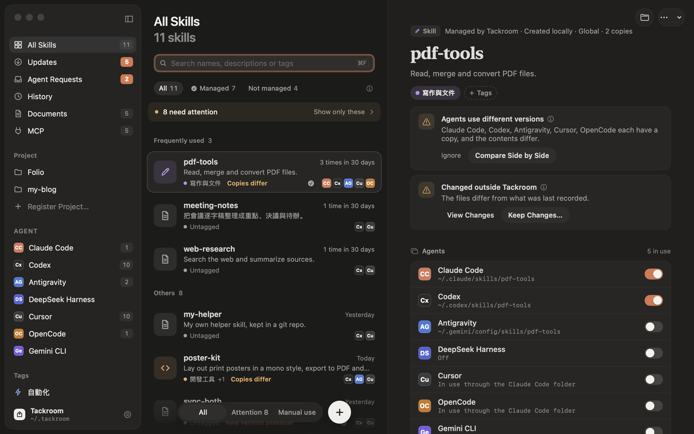
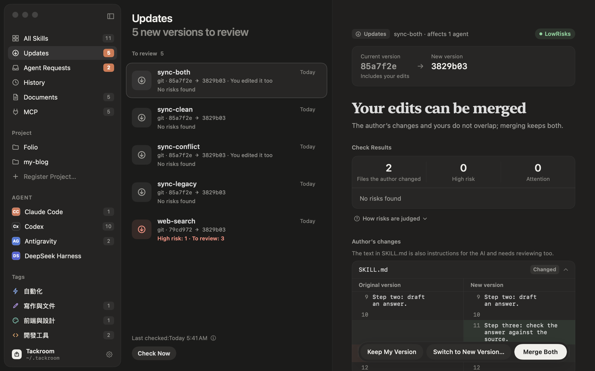

> [!IMPORTANT]
> **AI Development Disclosure**<br>
> The source code and documentation of Tackroom are produced primarily by AI agents (Anthropic Claude and OpenAI Codex). The maintainer's role is limited to setting the product's overall direction. We believe software developed by AI agents should be clearly disclosed as such and distinguished from software developed by humans.

# Tackroom

**One place to see, switch and safely update the skills of every AI coding agent on your Mac.**

Tackroom is a native macOS app for [Agent Skills](https://agentskills.io) (folders with a `SKILL.md`). Claude Code, Codex, Antigravity, Cursor and others each read skills from their own folders, and the same skill often ends up copied, outdated or changed in several places. Tackroom shows all of them side by side, keeps one copy of each skill you choose to manage, and links it into the agents you turn it on for.

> **Early preview (0.1).** It works on the author's Mac every day, but expect rough edges. Back up anything you care about, and read the preview Tackroom shows before you confirm a change.

[繁體中文說明在下方](#繁體中文)



## What it does

- **Overview.** Every skill each agent loads, where it comes from, and whether the copies differ, are loaded twice, or are broken links.
- **Manage.** Bring a skill under management and Tackroom keeps a single copy in `~/.tackroom/store` (a git repository) and links it into each agent's folder. Turn it on or off per agent with a switch.
- **Install.** From GitHub (`owner/repo` or a URL), a folder or a `.zip`, globally or into one project. A risk check runs first.
- **Review updates.** Tackroom checks upstream every 6 hours and separates the author's changes from your own edits. When both changed, it can merge them, keep yours, or take the new version. Risky additions (scripts that run, network calls, reading keys, instructions to hide things from you) are flagged in plain words.
  
- **Notice outside changes.** If a managed skill is edited outside Tackroom, you see the difference and choose to keep or restore it.
- **Undo.** Every change is a git commit and can be put back from History.
- **Agent requests.** Agents can look skills up and *propose* changes with the `tackroom` command line; nothing changes until you agree in the app.
- **Also:** a read-only overview of MCP servers (secret values are never shown), your instruction files (`CLAUDE.md`, `AGENTS.md`, `GEMINI.md`) with in-app editing, tags, and frequently used skills counted from conversation logs (names only; can be turned off).
- **Languages:** 繁體中文, 简体中文 and English.

## Supported agents

| Agent | Global skill folder Tackroom writes to | Status |
|---|---|---|
| Claude Code | `~/.claude/skills` | read and write |
| Codex | `~/.codex/skills` | read and write |
| Antigravity | `~/.gemini/config/skills` | read and write |
| DeepSeek Harness | `~/.dsh/skills` | read and write |
| Cursor | `~/.cursor/skills` | read and write |
| OpenCode | `~/.config/opencode/skills` | read and write |
| Gemini CLI | `~/.gemini/skills` | read and write |
| GitHub Copilot | — | read only, shown when installed |
| Devin CLI | — | read only, shown when installed |

Several agents also read each other's folders (Cursor and OpenCode read `~/.claude/skills`, for example). Tackroom models this, and the preview says which other agents a change reaches. The folders and precedence rules for each agent are in [`Sources/TackroomKit/Adapters.swift`](Sources/TackroomKit/Adapters.swift) and can be overridden in `~/.tackroom/adapters.toml`.

## Requirements

- macOS 14 or later, Apple silicon
- Xcode 16 or later (Swift 6) to build from source
- `git` (comes with the Xcode command line tools)

## Build and run

```bash
git clone https://github.com/a11oydyyy/tackroom.git
cd tackroom
./scripts/build-app.sh      # builds build/Tackroom.app, signed locally (no Apple account needed)
open build/Tackroom.app
```

The app is not notarized. If you download a prebuilt copy instead of building it, macOS will say it cannot verify the developer: right-click the app, choose **Open**, and confirm once.

Optional: in **Settings › Agent command line tool**, install `tackroom` into `~/.local/bin` so agents can look up skills and send requests.

## How it keeps your files safe

- Nothing is changed until you confirm a preview that lists every file it will touch.
- Removed folders go to the Trash; managed copies live in a git repository, so History can undo any change.
- Tackroom only adds or removes **links** in agent folders. It never edits an agent's settings files.
- Agents can only propose changes; you approve them in the app.
- Network access is limited to fetching skills you install and checking their upstream for updates.

## Development

```bash
swift test                        # unit tests (they only use temporary folders)
./scripts/verify-loaded.sh        # compares Tackroom's list with what each agent really loads
./scripts/check-localization.sh   # lists interface text missing a translation
```

- `Sources/TackroomKit/`: all logic (scanning, agent rules, store, operations, updates).
- `Sources/TackroomApp/`: SwiftUI interface.
- `Sources/tackroom/`: the command line tool for agents.
- `Localization/`: translations. Traditional Chinese is the source text and doubles as the key.

## Known limitations

- Early preview: no automatic app updates, no notarized build yet.
- Skills installed inside projects are not yet checked for updates.
- GitHub Copilot and Devin support follows their documentation and has not been tested on a real install.
- The `tackroom` command line prints Traditional Chinese.

## License

[MIT](LICENSE)

---

## 繁體中文

> [!IMPORTANT]
> **AI 開發聲明**<br>
> 本專案之程式碼與文件主要由 AI Agent（Anthropic Claude 與 OpenAI Codex）完成，維護者僅負責制定產品的整體方向。我們認為，由 AI Agent 開發的軟體應予以明確標示，並與人類開發的軟體有所區分。

**在一個地方看清、開關並安全更新 Mac 上每個 AI 程式 agent 的 skill。**

Tackroom 是 macOS 原生 app，管理 [Agent Skills](https://agentskills.io)（含 `SKILL.md` 的資料夾）。Claude Code、Codex、Antigravity、Cursor 等各自從不同資料夾讀 skill，同一個 skill 常常被複製好幾份、版本不同或被改過。Tackroom 把它們並排列出；你選擇納入管理的 skill 只保留一份，再用捷徑接到你要開啟的 agent。

> **早期預覽版（0.1）。** 作者每天在用，但仍可能有不完善的地方。重要資料請先備份，確認任何變更前請看過 Tackroom 列出的預覽。

**功能**：總覽各 agent 載入的 skill 與問題（副本不同、重複載入、捷徑失效）；納入管理後為各 agent 開關；從 GitHub、資料夾或 .zip 安裝（全域或單一專案），安裝前檢查風險；每 6 小時檢查上游更新，分開顯示作者的變更與你的修改，可合併；發現 Tackroom 以外的修改；每次變更都記在「紀錄」，可以恢復；agent 只能透過 `tackroom` 命令列送出請求，你同意才執行；另有 MCP 唯讀總覽（不顯示金鑰）、指令文件編輯、標籤、常用 skill（只數名字，可關閉）；介面支援繁體中文、简体中文、English。

**建置**：需要 macOS 14 以上（Apple 晶片）與 Xcode 16 以上。執行 `./scripts/build-app.sh` 後開啟 `build/Tackroom.app`。這個 app 沒有經過 Apple 公證，第一次開啟請在 app 上按右鍵選「打開」。

**安全原則**：確認前不做任何變更；移除的檔案放進垃圾桶；保管區是 git repo，紀錄可以恢復；只在 agent 資料夾增刪捷徑，不改 agent 的設定檔；只有安裝 skill 和檢查更新時才會連網。

授權：MIT。
